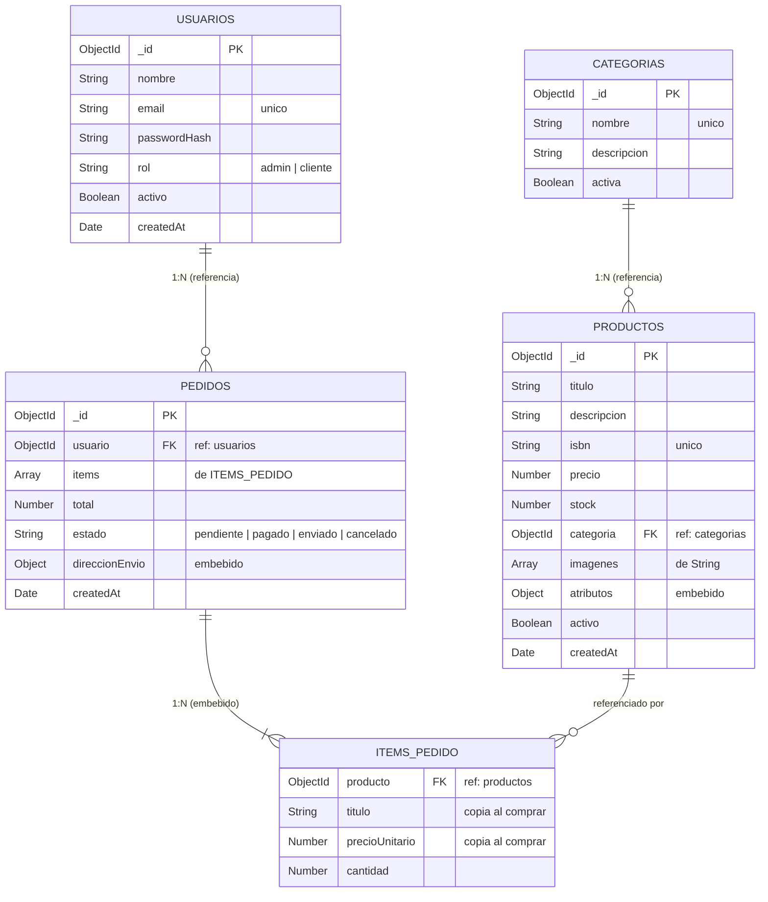

# TP Intermedio — Diseño del esquema de datos

Curso de Backend Developer · UTN BA · Evaluación Bases de Datos: Diseño de Esquema

---

## 1. Elección del dominio

API de **ventas e inventario** para una **librería online pequeña**: los **clientes** consultan el catálogo de libros y hacen pedidos, y los **administradores** gestionan categorías, libros y stock.

Mapeo con las entidades obligatorias:

| Entidad obligatoria | En este dominio | Colección |
|---|---|---|
| Usuarios | Clientes y administradores | `usuarios` |
| Entidad Principal | Producto (un libro del catálogo) | `productos` |
| Entidad Referenciada | Categoría (género o temática) | `categorias` |

Además se agrega una cuarta colección, `pedidos`, porque es lo que le da sentido al control de stock y permite mostrar decisiones de embeber y de referenciar en un mismo caso.

---

## 2. Diagrama del modelo



**Relaciones:**

- `categorias` → `productos`: **1:N**. Una categoría tiene muchos libros; cada libro pertenece a una categoría (`productos.categoria`, ObjectId).
- `usuarios` → `pedidos`: **1:N**. Un usuario realiza muchos pedidos (`pedidos.usuario`, ObjectId).
- `pedidos` → `items`: **1:N embebido**. Los ítems viven dentro del pedido y cada uno referencia al libro por `ObjectId`.

### Campos y tipos

**`usuarios`**

| Campo | Tipo | Obligatorio | Nota |
|---|---|---|---|
| `_id` | ObjectId | auto | |
| `nombre` | String | sí | |
| `email` | String | sí | único |
| `passwordHash` | String | sí | nunca se guarda la contraseña en texto plano |
| `rol` | String | sí | enum: `"admin"`, `"cliente"` (por defecto `"cliente"`) |
| `activo` | Boolean | no | por defecto `true` |
| `createdAt` | Date | auto | |

**`categorias`**

| Campo | Tipo | Obligatorio | Nota |
|---|---|---|---|
| `_id` | ObjectId | auto | |
| `nombre` | String | sí | único |
| `descripcion` | String | no | |
| `activa` | Boolean | no | por defecto `true` |

**`productos`** (libros)

| Campo | Tipo | Obligatorio | Nota |
|---|---|---|---|
| `_id` | ObjectId | auto | |
| `titulo` | String | sí | |
| `descripcion` | String | no | sinopsis |
| `isbn` | String | sí | único; identifica cada edición |
| `precio` | Number | sí | mayor o igual a 0 |
| `stock` | Number | sí | entero, mayor o igual a 0 |
| `categoria` | ObjectId | sí | referencia a `categorias` |
| `imagenes` | Array de String | no | URLs de portada |
| `atributos` | Object (embebido) | no | `{ autor, editorial, idioma, paginas, formato }` |
| `atributos.autor` | String | sí | |
| `atributos.editorial` | String | no | |
| `atributos.idioma` | String | no | |
| `atributos.paginas` | Number | no | entero, mayor a 0 |
| `atributos.formato` | String | no | enum: `"tapa blanda"`, `"tapa dura"`, `"digital"` |
| `activo` | Boolean | no | por defecto `true` |
| `createdAt` | Date | auto | |

**`pedidos`**

| Campo | Tipo | Obligatorio | Nota |
|---|---|---|---|
| `_id` | ObjectId | auto | |
| `usuario` | ObjectId | sí | referencia a `usuarios` |
| `items` | Array de Object | sí | al menos 1 ítem |
| `items[].producto` | ObjectId | sí | referencia a `productos` |
| `items[].titulo` | String | sí | copia del título al momento de comprar |
| `items[].precioUnitario` | Number | sí | copia del precio al momento de comprar |
| `items[].cantidad` | Number | sí | entero, mayor o igual a 1 |
| `total` | Number | sí | suma de `precioUnitario × cantidad` |
| `estado` | String | sí | enum: `"pendiente"`, `"pagado"`, `"enviado"`, `"cancelado"` |
| `direccionEnvio` | Object (embebido) | sí | `{ calle, ciudad, codigoPostal }`, todos String |
| `createdAt` | Date | auto | |

---

## 3. Justificación de embeber vs. referenciar

### Referenciado: `categorias` fuera de `productos`

La categoría es la Entidad Referenciada y va en una colección aparte porque:

- **Se reutiliza:** muchos libros comparten la misma categoría (por ejemplo, "Ficción"). Embeberla copiaría el mismo dato en cada libro.
- **Se actualiza de forma independiente:** si una categoría cambia de nombre, con referencia se modifica **un solo documento**. Embebida habría que actualizar todos los libros que la contienen y se corre el riesgo de dejar copias desactualizadas.
- **Se consulta por sí sola:** el administrador gestiona las categorías (alta, baja, listado) y el cliente filtra el catálogo por categoría. Esas operaciones no deberían depender de recorrer libros.
- **Evita la duplicación** y los datos inconsistentes entre libros de la misma categoría.

### Referenciado: `pedidos.usuario`

El pedido guarda solo el `ObjectId` del usuario. Los datos del usuario (nombre, email, rol) cambian por su cuenta y se usan en muchos lugares; copiarlos en cada pedido los dejaría desactualizados. Si hace falta el nombre, se obtiene con `populate`.

### Embebido: `atributos` dentro de `productos`

Datos como editorial, idioma, páginas o formato no se reutilizan en ninguna otra colección, no se actualizan por separado y siempre se leen junto con el libro. No justifican una colección propia.

El **autor** también se guarda como texto dentro de `atributos`. Es una decisión consciente de alcance: un mismo autor puede aparecer en varios libros, así que si en el futuro hace falta gestionar autores (ver todos los libros de un autor, su biografía), pasaría a ser una colección referenciada. Por ahora no se necesita y el modelo queda más simple.

### Embebido: `items` dentro de `pedidos`

- Un ítem **solo existe como parte de su pedido** y siempre se lee con él.
- La cantidad de ítems por pedido es **pequeña y acotada**.
- Cada ítem guarda una **copia del título y del precio** del libro al momento de la compra. Esto es intencional: el pedido es un registro histórico y no debe cambiar si mañana el libro sube de precio o se retitula en otra edición. Por eso aquí la copia no es un defecto sino un requisito.
- El ítem conserva además `producto` (ObjectId) para poder volver al libro original, por ejemplo para descontar stock.

### Embebido: `direccionEnvio` dentro de `pedidos`

La dirección es la que se usó **en ese pedido**; si el usuario se muda después, el pedido antiguo debe conservar su dirección original.

---

## 4. Índices propuestos

| Colección | Índice | Para qué sirve |
|---|---|---|
| `usuarios` | `{ email: 1 }` único | Impide registrar dos usuarios con el mismo email y acelera la búsqueda al iniciar sesión. |
| `categorias` | `{ nombre: 1 }` único | Evita categorías duplicadas. |
| `productos` | `{ isbn: 1 }` único | Garantiza que cada edición esté cargada una sola vez y permite buscar por ISBN. |
| `productos` | `{ categoria: 1 }` | Acelera el filtro del catálogo por categoría (el campo de referencia). |
| `productos` | `{ titulo: "text", descripcion: "text", "atributos.autor": "text" }` | Permite buscar libros por texto en título, sinopsis o autor. |
| `pedidos` | `{ usuario: 1, createdAt: -1 }` | Lista rápido los pedidos de un usuario, del más reciente al más antiguo. |
| `pedidos` | `{ estado: 1 }` | Acelera los filtros del administrador por estado del pedido. |

---

## 5. Documentos de ejemplo

> Nota: en el JSON, los `ObjectId` y las `Date` se muestran como texto por legibilidad. En MongoDB se guardan con su tipo nativo (`ObjectId` y `Date`). Los libros, autores e ISBN son ficticios.

### `usuarios`

```json
[
  {
    "_id": "665f1a2b3c4d5e6f7a8b9c01",
    "nombre": "Admin Principal",
    "email": "admin@libreria.com",
    "passwordHash": "$2b$10$hashDeEjemploAdmin",
    "rol": "admin",
    "activo": true,
    "createdAt": "2026-11-01T10:00:00.000Z"
  },
  {
    "_id": "665f1a2b3c4d5e6f7a8b9c02",
    "nombre": "Laura Gómez",
    "email": "laura@mail.com",
    "passwordHash": "$2b$10$hashDeEjemploLaura",
    "rol": "cliente",
    "activo": true,
    "createdAt": "2026-11-03T14:30:00.000Z"
  },
  {
    "_id": "665f1a2b3c4d5e6f7a8b9c03",
    "nombre": "Martín Ruiz",
    "email": "martin@mail.com",
    "passwordHash": "$2b$10$hashDeEjemploMartin",
    "rol": "cliente",
    "activo": true,
    "createdAt": "2026-11-05T09:15:00.000Z"
  }
]
```

### `categorias`

```json
[
  {
    "_id": "665f1a2b3c4d5e6f7a8b9d01",
    "nombre": "Ficción",
    "descripcion": "Novelas y cuentos",
    "activa": true
  },
  {
    "_id": "665f1a2b3c4d5e6f7a8b9d02",
    "nombre": "Tecnología",
    "descripcion": "Programación, bases de datos y desarrollo de software",
    "activa": true
  },
  {
    "_id": "665f1a2b3c4d5e6f7a8b9d03",
    "nombre": "Infantil",
    "descripcion": "Libros para niños y niñas",
    "activa": true
  }
]
```

### `productos`

```json
[
  {
    "_id": "665f1a2b3c4d5e6f7a8b9e01",
    "titulo": "El faro de cristal",
    "descripcion": "Novela sobre una farera que descubre un secreto en una isla remota",
    "isbn": "978-1-23456-001-1",
    "precio": 18.9,
    "stock": 30,
    "categoria": "665f1a2b3c4d5e6f7a8b9d01",
    "imagenes": ["https://example.com/portadas/faro-de-cristal.jpg"],
    "atributos": {
      "autor": "Irene Valdés",
      "editorial": "Ediciones Norte",
      "idioma": "es",
      "paginas": 320,
      "formato": "tapa blanda"
    },
    "activo": true,
    "createdAt": "2026-11-02T11:00:00.000Z"
  },
  {
    "_id": "665f1a2b3c4d5e6f7a8b9e02",
    "titulo": "Cuentos del río",
    "descripcion": "Colección de relatos breves ambientados a orillas de un río",
    "isbn": "978-1-23456-002-8",
    "precio": 14.5,
    "stock": 45,
    "categoria": "665f1a2b3c4d5e6f7a8b9d01",
    "imagenes": [],
    "atributos": {
      "autor": "Tomás Aguirre",
      "editorial": "Ediciones Norte",
      "idioma": "es",
      "paginas": 210,
      "formato": "tapa blanda"
    },
    "activo": true,
    "createdAt": "2026-11-02T11:10:00.000Z"
  },
  {
    "_id": "665f1a2b3c4d5e6f7a8b9e03",
    "titulo": "Node.js desde cero",
    "descripcion": "Introducción práctica al desarrollo backend con Node.js y Express",
    "isbn": "978-1-23456-003-5",
    "precio": 34.9,
    "stock": 20,
    "categoria": "665f1a2b3c4d5e6f7a8b9d02",
    "imagenes": ["https://example.com/portadas/nodejs-desde-cero.jpg"],
    "atributos": {
      "autor": "Carla Medina",
      "editorial": "Bit Libros",
      "idioma": "es",
      "paginas": 450,
      "formato": "tapa blanda"
    },
    "activo": true,
    "createdAt": "2026-11-02T11:20:00.000Z"
  },
  {
    "_id": "665f1a2b3c4d5e6f7a8b9e04",
    "titulo": "Bases de datos en la práctica",
    "descripcion": "Modelado relacional y no relacional con ejemplos reales",
    "isbn": "978-1-23456-004-2",
    "precio": 29.9,
    "stock": 15,
    "categoria": "665f1a2b3c4d5e6f7a8b9d02",
    "imagenes": [],
    "atributos": {
      "autor": "Hugo Paredes",
      "editorial": "Bit Libros",
      "idioma": "es",
      "paginas": 380,
      "formato": "digital"
    },
    "activo": true,
    "createdAt": "2026-11-02T11:30:00.000Z"
  },
  {
    "_id": "665f1a2b3c4d5e6f7a8b9e05",
    "titulo": "La noche de los gatos",
    "descripcion": "Cuento ilustrado sobre los gatos que salen a pasear de noche",
    "isbn": "978-1-23456-005-9",
    "precio": 12.0,
    "stock": 80,
    "categoria": "665f1a2b3c4d5e6f7a8b9d03",
    "imagenes": ["https://example.com/portadas/noche-de-los-gatos.jpg"],
    "atributos": {
      "autor": "Lucía Fernández",
      "editorial": "Pequeño Sol",
      "idioma": "es",
      "paginas": 48,
      "formato": "tapa dura"
    },
    "activo": true,
    "createdAt": "2026-11-02T11:40:00.000Z"
  }
]
```

### `pedidos`

```json
[
  {
    "_id": "665f1a2b3c4d5e6f7a8b9f01",
    "usuario": "665f1a2b3c4d5e6f7a8b9c02",
    "items": [
      {
        "producto": "665f1a2b3c4d5e6f7a8b9e01",
        "titulo": "El faro de cristal",
        "precioUnitario": 18.9,
        "cantidad": 1
      },
      {
        "producto": "665f1a2b3c4d5e6f7a8b9e05",
        "titulo": "La noche de los gatos",
        "precioUnitario": 12.0,
        "cantidad": 2
      }
    ],
    "total": 42.9,
    "estado": "enviado",
    "direccionEnvio": { "calle": "Av. Libertad 1234", "ciudad": "Buenos Aires", "codigoPostal": "C1012" },
    "createdAt": "2026-11-10T16:00:00.000Z"
  },
  {
    "_id": "665f1a2b3c4d5e6f7a8b9f02",
    "usuario": "665f1a2b3c4d5e6f7a8b9c03",
    "items": [
      {
        "producto": "665f1a2b3c4d5e6f7a8b9e03",
        "titulo": "Node.js desde cero",
        "precioUnitario": 34.9,
        "cantidad": 1
      },
      {
        "producto": "665f1a2b3c4d5e6f7a8b9e02",
        "titulo": "Cuentos del río",
        "precioUnitario": 14.5,
        "cantidad": 1
      }
    ],
    "total": 49.4,
    "estado": "pagado",
    "direccionEnvio": { "calle": "Calle Mitre 567", "ciudad": "Rosario", "codigoPostal": "S2000" },
    "createdAt": "2026-11-12T10:45:00.000Z"
  },
  {
    "_id": "665f1a2b3c4d5e6f7a8b9f03",
    "usuario": "665f1a2b3c4d5e6f7a8b9c02",
    "items": [
      {
        "producto": "665f1a2b3c4d5e6f7a8b9e04",
        "titulo": "Bases de datos en la práctica",
        "precioUnitario": 29.9,
        "cantidad": 1
      }
    ],
    "total": 29.9,
    "estado": "pendiente",
    "direccionEnvio": { "calle": "Av. Libertad 1234", "ciudad": "Buenos Aires", "codigoPostal": "C1012" },
    "createdAt": "2026-11-15T18:20:00.000Z"
  }
]
```
